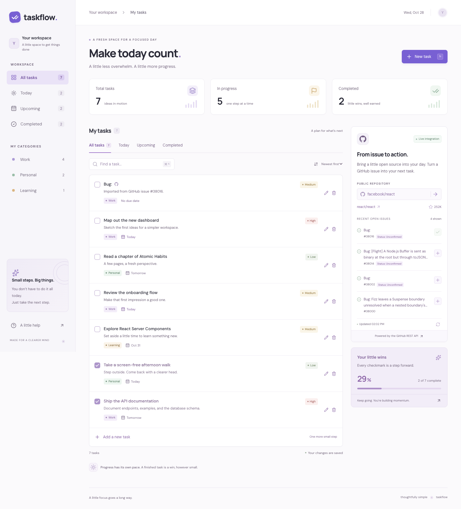

# Public API integration

**API:** GitHub REST API, public repository metadata and issues. No token or API key is required for this demo.

- `GET https://api.github.com/repos/{owner}/{repo}`
- `GET https://api.github.com/repos/{owner}/{repo}/issues?state=open&sort=created&direction=desc&per_page=30`
- [GitHub's official issues API documentation](https://docs.github.com/en/rest/issues/issues#list-repository-issues)

## Implementation

1. The GitHub panel starts with `facebook/react`. Enter any public `owner/repository` and submit the arrow button.
2. The browser calls the same-origin `/api/github?repo=...` endpoint. The server validates the repository name and builds URLs only on `api.github.com`.
3. The server fetches repository metadata and issues concurrently with JSON media headers, a User-Agent, an explicit API version, and an eight-second timeout per request.
4. GitHub's issues endpoint also returns pull requests. The adapter filters entries with `pull_request`, then returns at most four actual issues from the latest 30 results. The UI deliberately says **recent open issues**, rather than claiming this is an exhaustive issue list.
5. The panel displays the repository link, stars, issue titles and numbers, and fetch time. Loading, not-found, empty, timeout, rate-limit, and generic upstream errors have visible states with retry controls.
6. Selecting **+** creates a task through `POST /api/tasks`, preserving the issue URL. A SQL unique index prevents duplicate imports. The imported button changes to a checkmark. Editing and completing imported tasks use the same REST API as ordinary tasks.

Public requests use GitHub's unauthenticated request allowance. A busy shared deployment can hit that allowance. No credential is embedded in client code. Before higher-volume use, add a server secret for authenticated API calls, short-lived caching, and application rate limiting.

## Working integration screenshot



The screenshot is captured from the running application after a successful live GitHub response, with editable sample tasks for context. See `docs/VERIFICATION.md` for the observed checks.

## Commit evidence

The local commit containing the integration can be found with:

```sh
git log --oneline -- app/api/github/route.ts lib/github.ts app/github-panel.tsx
```

A GitHub commit URL is pending because no GitHub repository was supplied. Once pushed, the same commit is viewable at `https://github.com/OWNER/REPOSITORY/commit/<full SHA>`; see [submission instructions](SUBMISSION.md).
