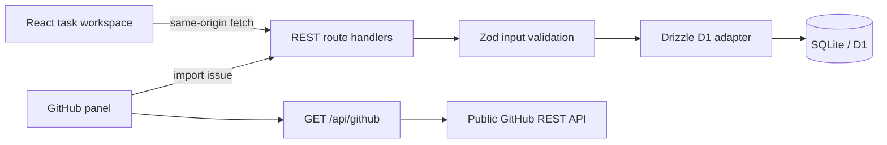

# Code review and architecture

The supplied Step 4 contains only a title. This is a review of the implementation and its architectural choices; no separate code sample or review rubric was provided.

## Structure and request flow

The frontend maintains a task list in memory and derives counts, filters, search results, and progress from that list. Every mutation waits for the API response before committing the returned row to UI state. Reloading reads the database again. No task state is persisted in localStorage.

Route handlers validate transport and input, execute database operations, and return JSON with clear HTTP status codes. Schema and SQL access are kept outside components. A single origin avoids a separate CORS deployment. The GitHub adapter shapes external data so the UI does not depend on GitHub's full response structure.

## Decisions and review observations

| Decision                         | Reason / implication                                                                                                                                                               |
| -------------------------------- | ---------------------------------------------------------------------------------------------------------------------------------------------------------------------------------- |
| React + TypeScript               | Components separate task editing, GitHub integration, and workspace interactions; types connect API payloads and UI state.                                                         |
| Vinext App Router on Workers     | Runs server-side REST endpoints and React together, matching the available hosting runtime. The framework is beta; pin the lockfile and assess support before production adoption. |
| D1 / SQLite + Drizzle            | Real durable SQL storage with versioned schema, typed operations, and parameterized queries; no local database service setup.                                                      |
| Server-owned UUID and timestamps | Clients cannot choose record IDs or alter audit fields. Completion and reopening update `completed_at` consistently.                                                               |
| Single UPDATE with RETURNING     | Avoids a read-before-write race and returns the committed row. Concurrent edits use last-write-wins, which is sufficient for this single-user assessment.                          |
| SQL uniqueness for imports       | A client-disabled button alone cannot prevent concurrent duplicates. The database provides the invariant.                                                                          |
| Runtime input validation         | Unknown keys, oversized payloads, wrong field types, blank titles, malformed UUIDs, and impossible dates fail before SQL.                                                          |
| Native dialog                    | Provides modal focus containment and Escape handling; visible labels, keyboard focus styles, and accessible controls are included.                                                 |
| Derived counts and progress      | One state source avoids separately updated totals going stale. Due dates are calendar dates in the browser's local timezone; audit times are UTC.                                  |
| Explicit example-data action     | Does not recreate deleted tasks or silently seed production data.                                                                                                                  |

The implementation does not render task or GitHub content as raw HTML. Repository lookup restricts upstream requests to a fixed GitHub API host. Request JSON buffering is capped at 20 KB, with excess bytes discarded and the request rejected, and browser writes reject mismatched Origin headers. Database errors are logged server-side and return a generic message, with the known duplicate-import conflict translated into HTTP 409.

## Deliberate limits and next steps

- **Access model:** this is one shared workspace, deployed with owner-private Sites access. The REST handlers do not implement application-level authentication. Before public or multi-user hosting, add authenticated identity, an `owner_id` foreign key, and ownership predicates on every read/update/delete; do not treat Origin checks as authentication.
- **Scale:** `GET /api/tasks` returns all tasks as requested by the assessment; filters and sorting run in the browser. For large datasets, introduce cursor pagination, indexed server-side filters, and text search.
- **External API:** unauthenticated GitHub requests can be rate limited. Add server-side caching, per-client throttling, and a stored server credential for heavier usage. The demo intentionally fetches on panel load, repository change, and explicit refresh.
- **Concurrency:** concurrent edits overwrite earlier edits. A version column with conditional updates would make conflicts explicit for collaboration.
- **Operations:** add structured request logs, error monitoring, database backups, and an automated deployment pipeline for a production team.
- **Quality:** automated tests cover domain validation, upstream failure mapping, REST behavior, real database persistence, and duplicate imports. Browser verification covers the core task flows and responsive layouts; ongoing CI could run these against disposable preview databases.

There are no known unresolved critical defects after the recorded verification. These limits describe the intended assessment scope rather than unimplemented assessment requirements.
